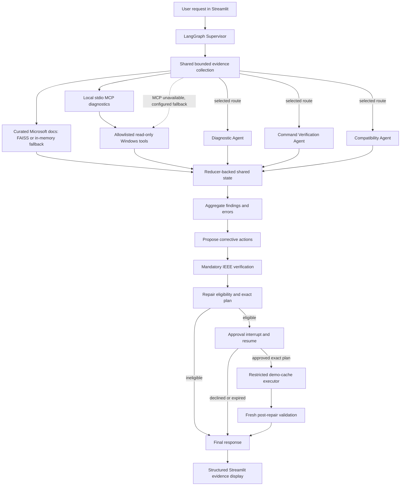

# OSGuard AI Architecture

OSGuard preserves the Supervisor, three specialist workflows, shared typed
state, verification gate, and controlled repair path. Phase 3 adds one shared
evidence collection node between classification and specialist routing. Phase 4
adds corrective-action proposals and the mandatory IEEE gate. Phase 5 adds
exact demo-cache repair planning, checkpointed approval, restricted execution,
and post-repair validation.

## Extended MCP diagnostic boundary (2026-11-22)

The existing Supervisor, collector, specialists, IEEE, and approval graph now
selects bounded read-only device, network, Windows Update, and software
inventories alongside its earlier tools. Selection uses classified subsystem,
request intent, advertised MCP capability names and descriptions, independent
argument schemas, and one evidence-driven follow-up. The MCP client permits
four initial calls and one distinct follow-up. Successful results retain tool
evidence IDs and backend labels.

New registry entries include `inspect_problem_devices`,
`inspect_device_status`, `inspect_device_drivers`,
`inspect_network_adapters`, `get_network_configuration`,
`inspect_dns_configuration`, `check_network_connectivity`,
`get_windows_update_history`, `inspect_failed_updates`,
`inspect_update_service_status`, `inspect_installed_software`,
`inspect_application_process`, and `inspect_application_errors`.
Device and Update inventory use fixed system PowerShell queries; PnPUtil is
a read-only device fallback. Network address and DNS metadata use psutil and
read-only registry data. Software inventory reads uninstall keys, never
`Win32_Product`. External connectivity is limited to one approved Microsoft
endpoint and a three-second maximum timeout. Tool outputs do not authorize
any action; IEEE verification and exact user approval still govern the sole
demo-cache repair. Private IPv4 literals are redacted from Groq prompts.

## Workflow

The Supervisor returns a Pydantic classification with intent, problem category,
OS subsystems, user-reported environment details, selected agents, missing
information, uncertainty, and a clarification question when needed. Conditional
routing invokes only selected specialists. Each specialist is invoked at most
once per graph run; multiple specialists currently run sequentially.

Before cloud inference, common Windows paths, account labels, email addresses,
SIDs, and explicitly labeled IP addresses are redacted from submitted text.
Retrieved documents and tool results are passed as bounded, explicitly
untrusted context. Redaction is conservative and cannot guarantee detection of
all sensitive information in arbitrary logs.

The graph creates one configured `ChatGroq` model and reuses it for the
Supervisor, specialists, candidate proposal, and IEEE structured assessment.
Its Pydantic outputs use Groq JSON Schema mode with best-effort schema
enforcement; application-side Pydantic validation and deterministic safety
rules still govern accepted findings and actions.
The evidence collector runs once after classification, performs at most one
documentation lookup, and invokes only the relevant fixed read-only tools.
It selects at most four distinct initial tools from the classified issue and
request text. A single deterministic follow-up is allowed when a successful
service check finds a named service stopped; that follow-up reads bounded
System events. There is no generic tool-calling loop. Classifier, model, retrieval function,
tools, specialists, action proposer, and IEEE assessor can be injected so tests
do not require Groq, the network, a local index, or host inspection.

The preferred diagnostic transport is the official Python MCP SDK over a
local stdio subprocess. The collector discovers advertised tool names,
descriptions and input schemas before selecting calls. A separate strict
client policy validates each argument, and the server wraps the same bounded
Python read-only functions. A call receives a backend label and retains its
tool evidence ID. The process is closed after the bounded collection batch.
If connection or discovery fails, a configured direct Python fallback runs
the same approved calls and reports that backend explicitly. MCP never exposes
the demo-cache repair, an arbitrary command, or a network listener. Set
`OSGUARD_DIAGNOSTIC_BACKEND=direct` to choose direct diagnostics; set
`OSGUARD_DIRECT_FALLBACK=0` to fail closed instead of falling back.

Approved known-folder tools resolve Downloads, Documents and Desktop with the
Windows Known Folder API. They inspect file metadata only, reject arbitrary
paths and reparse points, and cap depth, entry count and elapsed scan time.
Incomplete scans are labeled partial. The registry also includes bounded
uptime and service-list reads. Device and driver inventories use the same
approved registry and preserve the result's evidence provenance.

## Shared state and evidence provenance

`OSGuardState` is a `TypedDict` used by every LangGraph node. Findings, missing
information, uncertainty notes, tool results, retrieved evidence, specialist
results, completed-agent names, and errors use append reducers where multiple
nodes contribute. A specialist writes only its own finding channels.

The state carries:

- The original request, Supervisor classification, and selected specialists.
- User-reported or read-only observed environment details.
- User-quoted and tool-measured diagnostic observations, hypotheses, and safe
  information-gathering suggestions.
- Static command findings and compatibility findings with validated evidence IDs.
- Structured retrieval status, attributed passages, and bounded tool results.
- Missing information, uncertainty, workflow errors, and specialist status.
- Corrective recommendation candidates, one IEEE result per action ID, and
  explicit no-action/error summaries. The one eligible disposable demo-cache
  action also carries an exact repair plan, approval state, execution result,
  and fresh post-repair validation result.

Tool observations are accepted only when their quoted value appears in a
successful matching tool result. Hypothesis citations are retained only when
their exact support appears in the cited user text, tool result, or retrieved
passage. Compatibility requirements are retained only when their exact value
appears in a retrieved passage with a valid cited source ID. A high CPU or
memory reading is not treated as a confirmed root cause.

## Shared documentation retrieval

`data/documentation_sources.json` is the allowlist for official Microsoft Learn
pages. The indexer accepts HTTPS sources only from `learn.microsoft.com` or
`support.microsoft.com`, extracts and cleans HTML, preserves section metadata,
chunks text, generates local Sentence Transformers embeddings, and stores a
FAISS inner-product index plus JSON metadata and checksums under `data/faiss/`.
The Streamlit initialization control and `python -m osguard.rag.build_index`
both call the same preparation function: inspect the configured index, build
from the allowlisted pages only when needed, reload the artifacts, and verify
one search. The index and metadata are loaded once and cached; the application
does not rebuild the index per request. The local embedding model is cached
separately. Ingestion and retrieval use the same `data/faiss/` default and
embedding-model identity.

The local format contains `index.faiss`, `manifest.json`, and
`index.sha256.json`. Format version 2 records the producing app and a generation,
and checksums cover both the native index and manifest. Loading rejects links,
junctions, oversized files, invalid shapes, incompatible embedding models, and
source URLs outside the approved Microsoft hosts. No LangChain pickle metadata
or unsafe pickle deserialization is used. These checks detect corruption and
accidental changes, not a malicious actor who can replace all local artifacts;
only locally generated artifacts in the app-controlled index directory are
trusted. Incomplete or incompatible indexes can be rebuilt from sources.

Search is bounded to at most eight passages (four by default) and supports exact
metadata filters for category, OS version, and source ID. Empty queries, missing
or corrupt indexes, unsupported filters, no results, and retrieval errors are
returned as explicit statuses. Retrieved pages are untrusted references, not
commands or proof of a diagnosis.

FAISS remains the primary backend when its native library and persisted index
are available. If the documented Windows Application Control restriction blocks
the native library, the same retrieval interface loads the allowlisted Microsoft
pages through the existing HTML extractor and chunker, then indexes them with
LangChain `InMemoryVectorStore` and the existing local embedding model. That
store uses cosine similarity. It is cached once per process for each source
configuration and embedding instance; subsequent queries embed only the query.
The fallback requires network access when first constructed and is not
persisted. It activates only for the recognized Application Control native
block; an unbuilt FAISS index remains an explicit missing-index status. The
result carries an explicit backend label; failed construction returns no
evidence or citations. Other FAISS errors do not trigger fallback.

## Read-only Windows tools

The collector has an explicit function map; there is no generic command or
PowerShell execution interface.

- `get_system_info`: Windows version/build and architecture; no machine name.
- `get_process_stats`: at most 50 process rows, ranked by CPU for CPU issues or
  by resident working-set memory for memory issues. CPU sampling scans at most
  200 processes; the single-snapshot memory scan caps at 500. No command lines
  or user identities are collected. Process working sets can share pages and
  must not be added to estimate total physical memory use.
- `get_memory_info`: total, available, used memory and utilization.
- `get_disk_info`: capacity and filesystem for at most 24 local volumes.
- `get_service_status`: one exact validated service name, no wildcards.
- `get_event_logs`: a validated time window, at most 20 IDs, levels 1–5, at
  most 100 events, and only Application, System, or Setup logs. Security logs
  and arbitrary XPath are not accepted.

Permission-denied, unsupported-OS, missing-service, invalid-input, and failed
results remain explicit. The tools do not request elevation or modify Windows.
Event access can be denied by local policy or permissions.

## Specialist boundaries

### Diagnostic Agent

Analyzes the redacted request and shared evidence. User observations must quote
the request. Tool observations must quote an exact value from a successful
tool result; their descriptions are rebuilt from the matched quote and cite the
tool's evidence ID. Hypothesis quotes and citations must match supplied data.
Retrieved text and tool output are untrusted context, not instructions. The
agent may suggest non-invasive information-gathering steps but does not propose
repairs.

### Command Verification Agent

Reviews submitted command text with structured output, shared official
documentation, and deterministic static checks. Known mutating commands receive
high risk; unknown or complex commands remain unverified. Citation IDs must
match the shared retrieval result. No shell or PowerShell process is invoked,
and the schema fixes `should_execute` to `false`.

### Compatibility Agent

Separates user-reported versions, observed Windows metadata, documented
requirements, hypotheses, and missing facts. Installed application/runtime
versions are never inferred from OS metadata. Version comparisons require both
an explicit installed version and a cited requirement with a comparison
constraint; otherwise the result remains unknown. Installed software is not
inventoried.

## Corrective action proposals and IEEE verification

After specialist aggregation, every graph path enters the action proposal node
and then the IEEE verifier before the final response. For dependency
recommendations, the proposer runs only when the user asks for remediation and
a compatibility finding reports a user-reported installed version that
conflicts with a retrieved documented requirement. It asks the shared Groq
model for up to five structured candidates. The exact OSGuard demo-cache request
uses a separate deterministic candidate from its dedicated read-only inspection.
The proposal node reconstructs allowed dependency targets,
versions, rationale, evidence excerpts, effects, risks, and risk level from the
validated compatibility finding and retrieved source. A user-submitted
PowerShell command is never promoted into an action. With missing evidence,
unknown requirements, failed specialists without a usable finding, or a
command-verification request, it records an explicit no-action result.

For each candidate, Groq returns structured Intent, Environment, Evidence, and
Effect assessments. Deterministic checks then control the final result:

- **Intent:** a remediation request must be explicit, and the action must match
  the grounded dependency finding. A command-safety request or an explicit
  request for explanation only cannot authorize a correction.
- **Environment:** OS version/build and architecture must match documented
  requirements. Missing OS, architecture, prerequisite, or administrator
  information remains unknown. An unsupported environment fails.
- **Evidence:** every ID must exist in the current user text, a successful
  read-only tool result, or a retrieved passage. Each excerpt must match its
  source, the user-reported installed version must be cited, and the retrieved
  passage must contain the required version. An existing but unrelated source
  does not support the recommendation.
- **Effect:** an immutable operation policy supplies risk and known effects.
  Proposal operations include a dependency install/update recommendation,
  classified high risk and recommendation-only, and the fixed OSGuard
  disposable demo-cache clear operation, which is eligible only after all
  execution gates pass.
  Registry, file deletion, security, driver, service, permission, command, and
  unknown operations fail closed. Model-provided risk labels do not override
  this policy.

Overall is `supported` only when all four final checks pass, `unsupported` if
any check fails, and otherwise `uncertain`. A stable content-derived action ID
maps to exactly one result; reducer merges deduplicate by that ID. A supported
result means evidence-backed as a recommendation, not safe to execute or
authorized. Phase 5 independently calculates repair eligibility; a supported
IEEE recommendation alone cannot authorize execution.

## Failure, uncertainty, and deferred components

Retrieval status and tool status are stored separately from specialist errors.
Missing indexes and denied tools do not create evidence. Specialist errors are
represented as `WorkflowError` and failed `SpecialistResult` records; other
selected specialists can still complete and their findings are retained.

Phase 5 does not execute commands or modify Windows system settings. Only the
OSGuard-owned disposable demo-cache payload can be changed, after exact-plan
approval. The checkpoint and once-per-plan execution ledger are process-local;
other actions remain recommendation-only. See `docs/IMPLEMENTATION_GUIDE.md`
and `docs/PROGRESS.md` for requirements and verification status.

## Phase 6 runtime boundary

Live Groq text, Supervisor classification, and one workflow through each of the
three specialists have been checked on Windows 11. The local Sentence
Transformers model produced embeddings offline. Six read-only Windows tool
paths returned valid statuses; the event-log path parsed three recent records.
Streamlit started and its health endpoint responded, and its script ran under
Streamlit's headless AppTest without exceptions. Browser interaction remains a
manual check.

Native FAISS loading is blocked by Smart App Control on this host, so the
existing FAISS indexer and native retrieval have not been verified. A separate
live in-memory fallback lookup retrieved Microsoft passages with source IDs and
URLs. Offline tests cover routing, provenance, IEEE, approval, restricted
fixture repair, and validation; they do not prove native FAISS indexing or broad
Windows repair capability.
