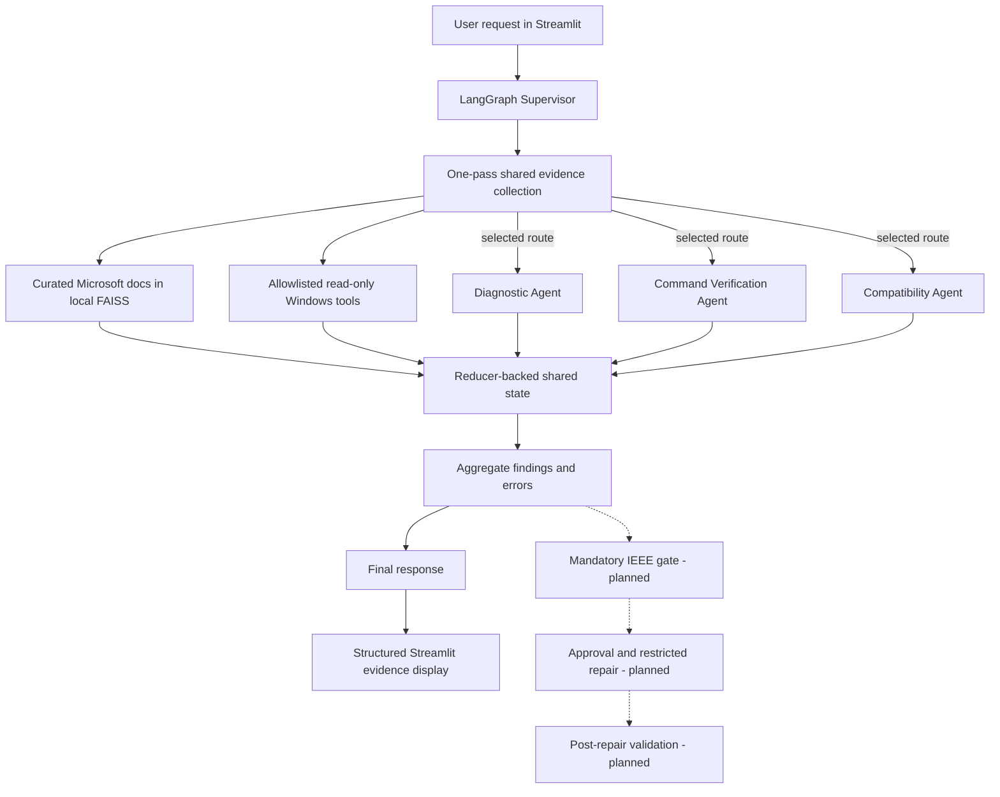

# OSGuard AI Architecture

OSGuard preserves the Supervisor, three specialist workflows, shared typed
state, verification gate, and controlled repair path. Phase 3 adds one shared
evidence collection node between classification and specialist routing. IEEE
verification and later repair components remain planned.

## Workflow

The Supervisor returns a Pydantic classification with intent, problem category,
OS subsystems, user-reported environment details, selected agents, missing
information, uncertainty, and a clarification question when needed. Conditional
routing invokes only selected specialists. Each specialist is invoked at most
once per graph run; multiple specialists currently run sequentially.

Before cloud inference, common Windows paths, account labels, email addresses,
SIDs, and explicitly labeled IP addresses are redacted from submitted text.
Retrieved documents and tool results are passed as bounded, explicitly
untrusted context. Redaction is conservative and cannot guarantee detection of
all sensitive information in arbitrary logs.

The graph creates one configured `ChatGroq` model and reuses it for the
Supervisor and specialist structured-output chains. The evidence collector
runs once after classification, performs at most one FAISS lookup, and invokes
only the relevant fixed read-only tools. It does not expose a generic tool
calling loop. Classifier, model, retrieval function, tools, and specialist nodes
can be injected so tests do not require Groq, the network, a local index, or
host inspection.

## Shared state and evidence provenance

`OSGuardState` is a `TypedDict` used by every LangGraph node. Findings, missing
information, uncertainty notes, tool results, retrieved evidence, specialist
results, completed-agent names, and errors use append reducers where multiple
nodes contribute. A specialist writes only its own finding channels.

The state carries:

- The original request, Supervisor classification, and selected specialists.
- User-reported or read-only observed environment details.
- User-quoted and tool-measured diagnostic observations, hypotheses, and safe
  information-gathering suggestions.
- Static command findings and compatibility findings with validated evidence IDs.
- Structured retrieval status, attributed passages, and bounded tool results.
- Missing information, uncertainty, workflow errors, and specialist status.
- Reserved IEEE, repair eligibility, approval, execution, and validation data.

Tool observations are accepted only when their quoted value appears in a
successful matching tool result. Hypothesis citations are retained only when
their exact support appears in the cited user text, tool result, or retrieved
passage. Compatibility requirements are retained only when their exact value
appears in a retrieved passage with a valid cited source ID. A high CPU or
memory reading is not treated as a confirmed root cause.

## Shared FAISS retrieval

`data/documentation_sources.json` is the allowlist for official Microsoft Learn
pages. The indexer accepts HTTPS sources only from `learn.microsoft.com` or
`support.microsoft.com`, extracts and cleans HTML, preserves section metadata,
chunks text, generates local Sentence Transformers embeddings, and stores a
FAISS inner-product index plus JSON metadata and checksums under `data/faiss/`.
The index and metadata are loaded once and cached; the application does not
rebuild the index per request. The local embedding model is cached separately.

Search is bounded to at most eight passages (four by default) and supports exact
metadata filters for category, OS version, and source ID. Empty queries, missing
or corrupt indexes, unsupported filters, no results, and retrieval errors are
returned as explicit statuses. Retrieved pages are untrusted references, not
commands or proof of a diagnosis.

## Read-only Windows tools

The collector has an explicit function map; there is no generic command or
PowerShell execution interface.

- `get_system_info`: Windows version/build and architecture; no machine name.
- `get_process_stats`: bounded CPU sample and at most 50 process rows; process
  scan capped at 200 and no command lines/user identities are collected.
- `get_memory_info`: total, available, used memory and utilization.
- `get_disk_info`: capacity and filesystem for at most 24 local volumes.
- `get_service_status`: one exact validated service name, no wildcards.
- `get_event_logs`: a validated time window, at most 20 IDs, levels 1–5, at
  most 100 events, and only Application, System, or Setup logs. Security logs
  and arbitrary XPath are not accepted.

Permission-denied, unsupported-OS, missing-service, invalid-input, and failed
results remain explicit. The tools do not request elevation or modify Windows.
Event access can be denied by local policy or permissions.

## Specialist boundaries

### Diagnostic Agent

Analyzes the redacted request and shared evidence. User observations must quote
the request. Tool observations must quote an exact value from a successful
tool result; their descriptions are rebuilt from the matched quote and cite the
tool's evidence ID. Hypothesis quotes and citations must match supplied data.
Retrieved text and tool output are untrusted context, not instructions. The
agent may suggest non-invasive information-gathering steps but does not propose
repairs.

### Command Verification Agent

Reviews submitted command text with structured output, shared official
documentation, and deterministic static checks. Known mutating commands receive
high risk; unknown or complex commands remain unverified. Citation IDs must
match the shared retrieval result. No shell or PowerShell process is invoked,
and the schema fixes `should_execute` to `false`.

### Compatibility Agent

Separates user-reported versions, observed Windows metadata, documented
requirements, hypotheses, and missing facts. Installed application/runtime
versions are never inferred from OS metadata. Version comparisons require both
an explicit installed version and a cited requirement with a comparison
constraint; otherwise the result remains unknown. Installed software is not
inventoried.

## Failure, uncertainty, and deferred components

Retrieval status and tool status are stored separately from specialist errors.
Missing indexes and denied tools do not create evidence. Specialist errors are
represented as `WorkflowError` and failed `SpecialistResult` records; other
selected specialists can still complete and their findings are retained.

Phase 3 does not execute commands or modify Windows. The following architecture
components remain future work:

1. The mandatory Intent, Environment, Evidence, Effect (IEEE) verification gate.
2. Repair planning, exact per-action user approval, and a restricted executor.
3. Post-repair validation and evidence-backed reporting.

These components must be added in implementation-guide order without changing
the Supervisor or specialist architecture. See `docs/IMPLEMENTATION_GUIDE.md`
and `docs/PROGRESS.md` for status.
