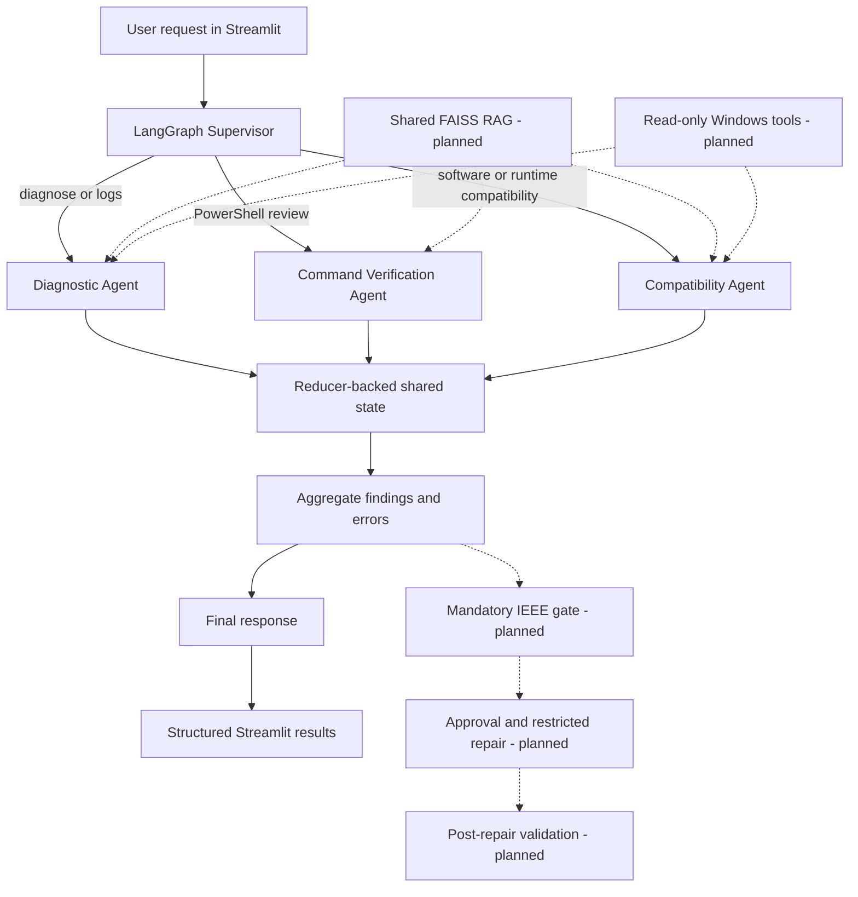

# OSGuard AI Architecture

OSGuard keeps the agreed Supervisor, three specialist workflows, shared typed
state, verification gate, and controlled repair path. The current implementation
covers the Supervisor and text-only specialist analysis. Later architecture
components remain planned and are not represented as working features.

## Workflow

The Supervisor returns a Pydantic classification with intent, problem category,
OS subsystems, explicitly user-reported environment details, selected agents,
missing information, uncertainty, and a clarification question when needed.
Conditional routing invokes only selected specialists. A specialist is invoked
at most once per graph run. Multi-specialist calls currently run sequentially.

Before cloud inference, common Windows paths, account labels, email addresses,
SIDs, and explicitly labeled IP addresses are redacted from submitted text.
Quote grounding and command matching use the same redacted text. A redacted
command target remains unknown in static review. The filter is conservative but
cannot guarantee detection of every sensitive value.

The graph builds one configured `ChatGroq` model and reuses it for the
Supervisor and all three specialist structured-output chains. The model and
specialist nodes can be injected so graph execution can be isolated from live
Groq calls. Pydantic schemas validate each model response before it reaches
shared state.

## Shared state and merging

`OSGuardState` is a `TypedDict` used by every LangGraph node. Findings, missing
information, uncertainty notes, specialist results, completed-agent names, and
errors use append reducers. A specialist writes only its own result channels;
it does not replace another specialist's findings. If an agent fails, the graph
records a bounded error result and continues to any remaining selected agent.
The final response reports partial failure while retaining successful outputs.

The state carries:

- The original request and Supervisor classification.
- User-reported environment details and selected specialists.
- Diagnostic symptoms, quoted observations, hypotheses, and safe information-
  gathering suggestions.
- Static command findings and compatibility findings.
- Missing information, uncertainty, workflow errors, and specialist statuses.
- Reserved evidence, IEEE, repair eligibility, approval, execution, and
  validation channels for later milestones.

## Specialist boundaries

### Diagnostic Agent

Analyzes only the redacted text the user submitted. It separates quoted user reports from
hypotheses and requires supporting quotes for both observations and hypotheses.
The node checks that quotes occur in the redacted request before recording them. It can
suggest non-invasive information-gathering steps, but it does not inspect
processes, event logs, services, or other host state. Its suggestions are
displayed as not performed.

### Command Verification Agent

Reviews command text with a structured LLM response and a deterministic static
policy. A small explicit list identifies supported read-only command names;
known mutating operations receive a high-risk classification, and unrecognized
commands remain unknown. Findings retain user intent, potential effects,
unknown parts, and administrative uncertainty. No shell, PowerShell process,
or command is invoked. The schema fixes `should_execute` to `false`.

### Compatibility Agent

Separates user-reported versions and requirements from hypotheses. Version,
operating-system, and architecture claims are retained only when the exact text
appears in the redacted user's input. A compatible/incompatible result is produced only
when both versions and an explicit comparison constraint can be evaluated;
otherwise the result remains unknown and the agent requests missing details.
The agent does not inspect installed software or retrieve vendor requirements.

## Failure and uncertainty handling

Invalid structured output, provider errors, missing configuration, and other
specialist errors are represented as `WorkflowError` and a failed
`SpecialistResult`. They do not prevent other selected specialists from
running. The final response identifies which work completed and whether a
partial failure occurred. User-reported text is not presented as independently
verified host data. No confidence score is treated as evidence.

## Safety and deferred components

This milestone does not execute commands or modify Windows. It does not collect
host measurements, access logs, query installed packages, or perform repairs.
The following architecture components remain future work:

1. Trusted-document retrieval through the shared FAISS knowledge base.
2. Approved read-only Windows diagnostic tools and system metadata.
3. The mandatory Intent, Environment, Evidence, Effect (IEEE) verification
   gate before corrective recommendations or actions.
4. Repair planning, exact per-action user approval, and a restricted executor.
5. Post-repair validation and evidence-backed reporting.

These components must be added in the implementation-guide order without
changing the Supervisor and specialist architecture. See
`docs/IMPLEMENTATION_GUIDE.md` and `docs/PROGRESS.md` for scope and status.
